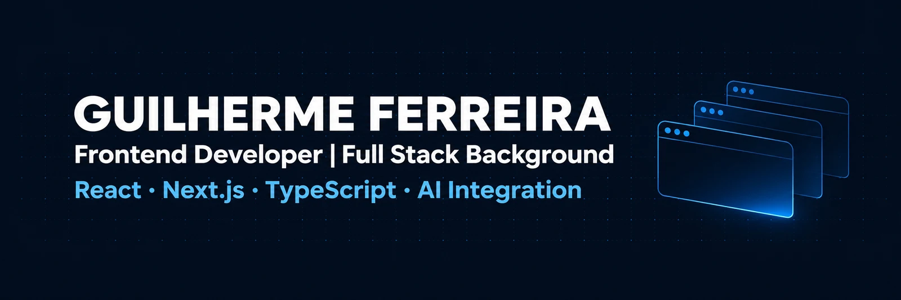

[Featured projects](#featured-projects) · [Portfolio](https://fsgui89.github.io/portfolio-guilherme-ferreira/) · [LinkedIn](https://www.linkedin.com/in/guilhermefsdev/)

## About Me

I'm a **Frontend Developer specializing in React**, with Full Stack training and complementary backend knowledge. I build responsive interfaces with React, Next.js and TypeScript, develop reusable components and integrate REST APIs. I care about accessible interactions, clear user flows and code that's easy to review and improve.

At Nexso, I contribute to SaaS frontend development. I use AI-assisted development to work through implementation options and keep code review focused.

Leia em português

Sou **Frontend Developer especializado em React**, com formação Full Stack e conhecimentos complementares de backend. Desenvolvo interfaces responsivas com React, Next.js e TypeScript, construo componentes reutilizáveis e integro APIs REST. Trabalho com atenção à acessibilidade, à experiência do usuário e à qualidade do código.

Na Nexso, contribuo com o desenvolvimento frontend de soluções SaaS. Uso IA para planejar soluções, apoiar a implementação e revisar o código. Eu valido as entregas com base nos requisitos do produto e sou responsável pelas decisões técnicas.

## Tech Stack

**Frontend**

**Backend & Integration** · Complementary skills

**Development & Quality**

Responsive design · Accessibility · Design systems · Testing and code quality · Web performance

**AI-Assisted Development**

AI integration · AI-assisted coding · Problem solving · Code review · Development productivity

## Featured Projects

| Preview | Project |
| :--- | :--- |
|  | **Portfolio 2.0** A multilingual portfolio in English, Portuguese and Italian, with responsive navigation and a browsable project showcase. React · TypeScript · Vite · CSS [Code](https://github.com/fsgui89/portfolio-guilherme-ferreira) · [Demo](https://fsgui89.github.io/portfolio-guilherme-ferreira/) |
|  | **TaskFlow** A task manager with reusable components, typed task states, completion filters and browser persistence. React · TypeScript · Vite · CSS [Code](https://github.com/fsgui89/todo-list-react) · [Demo](https://fsgui89.github.io/todo-list-react/) |
|  | **StepZone** A sneaker storefront prototype with product pages, shared cart state and a simulated checkout. Next.js · TypeScript · Tailwind CSS [Code](https://github.com/fsgui89/stepzone) · [Demo](https://fsgui89.github.io/stepzone/) |
|  | **PetCare** A scheduling prototype with booking, confirmation and an appointment management dashboard. Next.js · TypeScript · CSS Modules [Code](https://github.com/fsgui89/petcare) · [Demo](https://fsgui89.github.io/petcare/) |
|  | **Agência Aurora** A responsive agency landing page built from reusable React components with scoped styles. Next.js · TypeScript · CSS Modules [Code](https://github.com/fsgui89/agencia-aurora) · [Demo](https://fsgui89.github.io/agencia-aurora/) |
|  | **Torcida Brasil** A storefront prototype with catalog filters and a multi-page flow covering the cart, simulated checkout and confirmation. JavaScript · HTML · CSS [Code](https://github.com/fsgui89/torcida-brasil) · [Demo](https://fsgui89.github.io/torcida-brasil/) |

## AI-Assisted Software Development

I start by translating requirements into clear behavior, edge cases and a plan. I use AI to compare approaches, turn that logic into code and spot issues during review. I own the technical decisions and validate the result against requirements, test cases and real user flows before shipping.

## Connect With Me

[LinkedIn](https://www.linkedin.com/in/guilhermefsdev/) · [Portfolio](https://fsgui89.github.io/portfolio-guilherme-ferreira/) · [Email](mailto:fsgui89@gmail.com)
